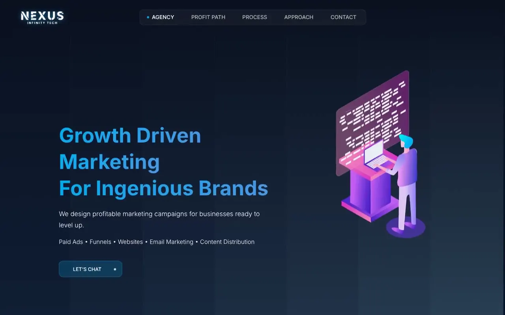

# Nexus Infinity Tech, company website

The company website I designed and built for Nexus Infinity Tech, a London-based tech company, on a remote contract (September to December 2025). The company has since retired its domain, so this repo now runs an archived copy.

**Archived site:** [nexus-frontend-ashen-kappa.vercel.app](https://nexus-frontend-ashen-kappa.vercel.app)



## What's on it

- **An entrance screen** before the site opens
- **Animated backgrounds:** an aurora shader behind the hero and a canvas animation behind the contact section
- **An interactive 3D globe** and a dotted world map to show where the company works
- **A process timeline** that walks through how a project runs
- **Magnetic buttons** and scroll-driven animations throughout, responsive from phone to desktop
- **A contact form** that sends enquiries to the company's API
- **A small admin area** where staff sign in to see enquiries, filter them by date, export them to CSV and delete them

## Built with

React 19 (Create React App), GSAP, Framer Motion, Three.js, Cobe (globe), Lottie, Axios.

## Structure

```
src/
  components/    Hero, About, Growth, Globe, PremiumProcessTimeline, Contact, Footer, ...
  admin/         Login, Dashboard and the protected route
  context/       admin sign-in state
  hooks/  styles/  assets/
```

## Run it

```bash
npm install --legacy-peer-deps
npm start       # http://localhost:3000
```

---

Built by [Muhammad Rayyan](https://rayyan-portfolio-xi.vercel.app).
